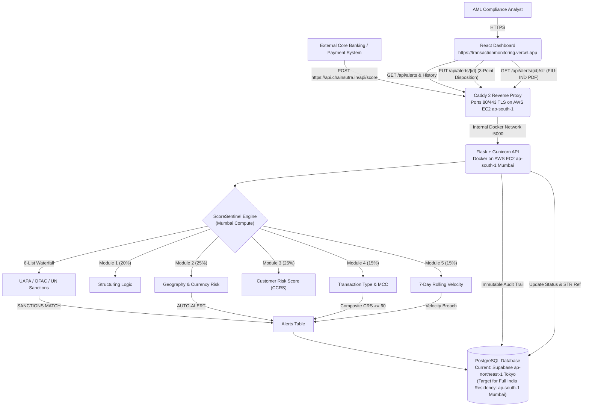

# TECH_STACK_EXPLAINED.md — ScoreSentinel Architecture & Data Flow

**ScoreSentinel AML Transaction Risk Scoring Engine**
**Version:** 1.3 | **Day:** 60 of 60 | **Author:** Atul Krishnan, CAMS
**Last Updated:** 1 November 2026

---

## 1. System Architecture Overview

ScoreSentinel is built using a modern "Full Stack" architecture, combining specialized components for logic execution, data persistence, and user interaction. The system is designed for **explainability, speed, and India-hosted deployment to support clients' own data-residency requirements**.

| Component | Technology | Primary Role |
|---|---|---|
| **Scoring Engine** | Python 3.11 | Logic execution — implements 5-module AML rules, sanctions waterfall, velocity, and FIU-IND STR generation |
| **API & Reverse Proxy** | Flask + Gunicorn + Caddy 2 (Docker Compose) | Data ingress/egress — containerised REST API deployed on **AWS EC2 (`ap-south-1` Mumbai)** behind Caddy 2 HTTPS (`https://api.chainsutra.in`) |
| **Database** | PostgreSQL | Persistence — currently hosted on **Supabase (`ap-northeast-1` Tokyo)** as detected by `scripts/check_db_region.py`; migration to **`ap-south-1` (Mumbai)** required for full India data residency |
| **Dashboard** | React | UI/UX — analyst case management interface, 3-point verification, STR generation, and Tuning Lab |
| **Infrastructure** | AWS EC2 (`ap-south-1`) + Vercel | Cloud hosting — API hosted in Mumbai (`ap-south-1`); database migration to `ap-south-1` in progress |

---

## 2. Component Deep Dive

### 2.1 The Scoring Engine (Python)
The "Brain" of ScoreSentinel. Python was chosen for its dominance in data science and its ability to represent complex conditional logic (if-then-else) in a way that is readable by both developers and compliance officers.
- **Sequential Execution:** Logic follows the five-module structure (Customer 25% → Structuring 20% → Geography 25% → Transaction Type 15% → 7-Day Velocity 15%) plus configurable rules scenarios (`SCN-001` to `SCN-010`).
- **Independent Modules:** Each module is a discrete Python script, allowing for easier updates and independent testing.
- **Fail-Fast Sanctions Waterfall:** Screens against 6 sanctions lists (UAPA Schedules 1 & 4, UNSC 1267/1988, OFAC SDN, UN Consolidated) and sanctioned jurisdictions, triggering an immediate AUTO-ALERT.

### 2.2 The API Layer (Flask + Gunicorn + Caddy 2 on AWS EC2 Mumbai `ap-south-1`)
The "Door" to the system. Flask is packaged inside a production `python:3.11-slim` Docker container (`api/Dockerfile.aws`) served by Gunicorn and fronted by **Caddy 2** (`docker-compose.prod.yml`) on **AWS EC2 (`t3.small` / `t4g.small`, `ap-south-1` Mumbai)**.
- **Hosting & Residency Status:** Deploying the API container on **AWS EC2 Mumbai (`ap-south-1`)** ensures that transaction scoring, sanctions screening, and FIU-IND STR PDF generation execute in Mumbai (`https://api.chainsutra.in`). Port `5000` is exposed only on the internal Docker network (`expose: ["5000"]`), while Caddy terminates TLS on ports `80`/`443`.
- **POST /api/score:** Accepts JSON transaction data, passes it to the engine, and returns the composite risk score and triggered rules.
- **PUT /api/alerts & GET /api/alerts/{id}/str:** Allows analysts to record dispositions following the Three-Point Documentation Standard and generate watermarked FIU-IND Suspicious Transaction Report (STR) PDFs (with automatic `DEMONSTRATION DOCUMENT - NOT A REGISTERED FIU-IND FILING` headers when `REPORTING_ENTITY_FIU_REG_NO` starts with `DEMO`).
- **Security:** Enforces startup validation on `DEMO_API_KEY` and `READ_API_KEY` (rejecting missing, short, duplicate, or placeholder keys), rate limiting (`Flask-Limiter`), parameterized SQL queries, and strict CORS allowlisting for `https://transactionmonitoring.vercel.app`.

### 2.3 The Database (PostgreSQL — Current Hosting vs. India Residency Requirement)
The "Memory" of the system. An enterprise-grade relational database.
- **Honest Hosting Status (`scripts/check_db_region.py`):**
  - **API Location:** AWS EC2 Mumbai (`ap-south-1`).
  - **Current Database Location:** Supabase PostgreSQL in **`ap-northeast-1` (Tokyo)** (verified via `python scripts/check_db_region.py` -> `NOT India-hosted: detected ap-northeast-1`).
  - **Data-Residency Requirement:** Full India data residency requires the PostgreSQL database itself to be hosted in **`ap-south-1` (Mumbai)** (either by provisioning a new Supabase project in Mumbai `ap-south-1` or migrating to AWS RDS for PostgreSQL in `ap-south-1`). Until that migration is completed, the environment is accurately described as: **API hosted in Mumbai (`ap-south-1`); database migration to `ap-south-1` in progress.**
- **Transactions Table:** INSERT-ONLY immutable audit trail storing every field and raw/normalised module score from every transaction attempt.
- **Customers Table:** Stores CCRS (Customer Risk Score) components, PEP tier, and beneficial ownership data.
- **Alerts Table:** Stores case management metadata (timestamps, reviewer IDs, 3-point identifiers, dispositions, and FIU-IND `str_reference` numbers).

### 2.4 The Dashboard (React on Vercel)
The "Face" of the system. A modern web interface connected to `https://api.chainsutra.in`.
- **Real-time Queue:** Displays alerts as they are generated by the engine, including IBM AML dataset badges.
- **Explainability UI:** Shows a visual breakdown of the composite score across all risk dimensions and rules fired.
- **Case Management & STR Filing:** Enforces the "Three-Point Decision Standard" and provides one-click **Preview STR** (JSON) and **Generate STR** (FIU-IND PMLA Section 12 PDF download) once an alert is disposed.

---

## 3. Architecture & Data Flow Diagram

The diagram below illustrates how transaction payloads enter **Caddy 2 (`https://api.chainsutra.in`)** on **AWS EC2 (`ap-south-1` Mumbai)**, proxy to the internal **Flask + Gunicorn API** container, execute across the scoring and sanctions modules, persist to **Supabase PostgreSQL (currently `ap-northeast-1` Tokyo; migration to `ap-south-1` Mumbai required for full India residency)**, and serve the **Vercel React Dashboard**:

---

## 4. Cloud Deployment Topology

| Layer | Provider | Region / Endpoint | Instance / Plan |
|---|---|---|---|
| **Reverse Proxy & TLS** | **Caddy 2 (`docker-compose.prod.yml`)** | **`ap-south-1` (Mumbai, India)** — `https://api.chainsutra.in` (ports `80`/`443`) | Open Source |
| **API & Engine** | **AWS EC2 (`t3.small` or `t4g.small`)** | **`ap-south-1` (Mumbai, India)** — internal port `5000` (`expose: ["5000"]`) | 2 GiB RAM, 30 GiB `gp3` |
| **Database** | **Supabase PostgreSQL** | **Current: `ap-northeast-1` (Tokyo)** — *Migration to **`ap-south-1` (Mumbai)** required for full India data residency* | Managed PostgreSQL |
| **Dashboard** | **Vercel** | [transactionmonitoring.vercel.app](https://transactionmonitoring.vercel.app) | Hobby Plan |

---

## 5. Model Governance & Regulatory Alignment

The choice of this tech stack directly supports **SR 11-7**, **PMLA 2002**, and **FIU-IND** operational workflows:
- **Transparency (No Black Box):** Unlike unexplainable neural networks, ScoreSentinel's Python code can be line-by-line audited by an independent validator.
- **Data Integrity:** PostgreSQL foreign keys and `INSERT-ONLY` transaction logging ensure that an alert can never be separated from its underlying transaction or customer state at the time of scoring.
- **Demonstration Safety:** When `REPORTING_ENTITY_FIU_REG_NO` begins with `DEMO` (such as `DEMO-ONLY`), every page of a generated STR PDF is stamped with `DEMONSTRATION DOCUMENT - NOT A REGISTERED FIU-IND FILING` in addition to the diagonal `DRAFT — PENDING REVIEW` watermark.
