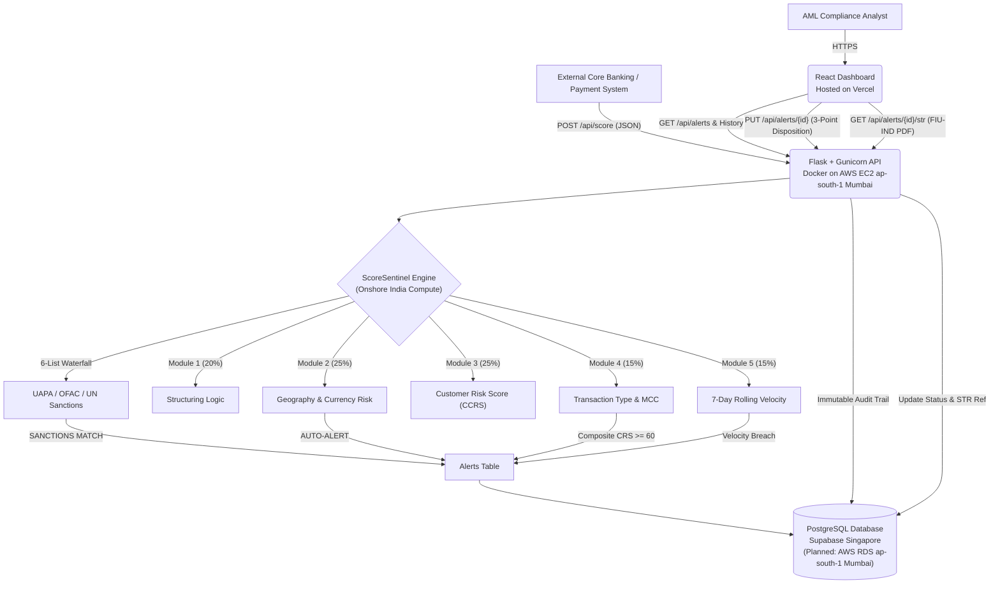

# TECH_STACK_EXPLAINED.md — ScoreSentinel Architecture & Data Flow

**ScoreSentinel AML Transaction Risk Scoring Engine**
**Version:** 1.2 | **Day:** 60 of 60 | **Author:** Atul Krishnan, CAMS
**Last Updated:** 30 October 2026

---

## 1. System Architecture Overview

ScoreSentinel is built using a modern "Full Stack" architecture, combining specialized components for logic execution, data persistence, and user interaction. The system is designed for **explainability, speed, RBI data localisation alignment, and Free Tier cloud deployment**.

| Component | Technology | Primary Role |
|---|---|---|
| **Scoring Engine** | Python 3.11 | Logic execution — implements 5-module AML rules, sanctions waterfall, velocity, and FIU-IND STR generation |
| **API Layer** | Flask + Gunicorn (Docker) | Data ingress/egress — containerised REST API deployed on **AWS EC2 (`ap-south-1` Mumbai)** |
| **Database** | PostgreSQL | Persistence — hosted on **Supabase (Singapore)** with planned migration to **AWS RDS Mumbai (`ap-south-1`)** |
| **Dashboard** | React | UI/UX — analyst case management interface, 3-point verification, STR generation, and Tuning Lab |
| **Infrastructure** | AWS EC2 (`ap-south-1`) + Vercel | Cloud hosting — Indian onshore compute in Mumbai (`ap-south-1`) for RBI data localisation compliance |

---

## 2. Component Deep Dive

### 2.1 The Scoring Engine (Python)
The "Brain" of ScoreSentinel. Python was chosen for its dominance in data science and its ability to represent complex conditional logic (if-then-else) in a way that is readable by both developers and compliance officers.
- **Sequential Execution:** Logic follows the five-module structure (Customer 25% → Structuring 20% → Geography 25% → Transaction Type 15% → 7-Day Velocity 15%) plus configurable rules scenarios (`SCN-001` to `SCN-010`).
- **Independent Modules:** Each module is a discrete Python script, allowing for easier updates and independent testing.
- **Fail-Fast Sanctions Waterfall:** Screens against 6 sanctions lists (UAPA Schedules 1 & 4, UNSC 1267/1988, OFAC SDN, UN Consolidated) and sanctioned jurisdictions, triggering an immediate AUTO-ALERT.

### 2.2 The API Layer (Flask + Docker on AWS EC2 Mumbai `ap-south-1`)
The "Door" to the system. Flask is packaged inside a production `python:3.11-slim` Docker container served by Gunicorn on **AWS EC2 (`t2.micro`, `ap-south-1` Mumbai)**.
- **RBI Data Localisation Alignment:** Migrating the API compute layer from US-hosted Render servers to **AWS EC2 Mumbai (`ap-south-1`)** ensures that transaction scoring, sanctions screening, and FIU-IND STR PDF generation execute onshore within India in alignment with the RBI Circular on Storage of Payment System Data (2018) and DPDP Act 2023.
- **POST /api/score:** Accepts JSON transaction data, passes it to the engine, and returns the composite risk score and triggered rules.
- **PUT /api/alerts & GET /api/alerts/{id}/str:** Allows analysts to record dispositions following the Three-Point Documentation Standard and generate watermarked FIU-IND Suspicious Transaction Report (STR) PDFs.
- **Security:** Enforces `X-DEMO-API-KEY` and `X-READ-API-KEY` authentication, rate limiting (`Flask-Limiter`), parameterized SQL queries, and strict CORS allowlisting for the Vercel frontend and EC2 IP.

### 2.3 The Database (PostgreSQL — Supabase Singapore → Planned AWS RDS Mumbai)
The "Memory" of the system. An enterprise-grade relational database.
- **Current Hosting & Localisation Roadmap:** Currently hosted on **Supabase PostgreSQL (Singapore region)** for zero-cost managed persistence, with a **planned migration to AWS RDS for PostgreSQL in `ap-south-1` (Mumbai)** to achieve complete end-to-end onshore data residency alongside the AWS EC2 Mumbai API instance.
- **Transactions Table:** INSERT-ONLY immutable audit trail storing every field and raw/normalised module score from every transaction attempt.
- **Customers Table:** Stores CCRS (Customer Risk Score) components, PEP tier, and beneficial ownership data.
- **Alerts Table:** Stores case management metadata (timestamps, reviewer IDs, 3-point identifiers, dispositions, and FIU-IND `str_reference` numbers).

### 2.4 The Dashboard (React on Vercel)
The "Face" of the system. A modern web interface connected to the AWS EC2 Mumbai API.
- **Real-time Queue:** Displays alerts as they are generated by the engine, including IBM AML dataset badges.
- **Explainability UI:** Shows a visual breakdown of the composite score across all risk dimensions and rules fired.
- **Case Management & STR Filing:** Enforces the "Three-Point Decision Standard" and provides one-click **Preview STR** (JSON) and **Generate STR** (FIU-IND PMLA Section 12 PDF download) once an alert is disposed.

---

## 3. Architecture & Data Flow Diagram

The diagram below illustrates how transaction payloads enter the **AWS EC2 (`ap-south-1` Mumbai)** Docker container, execute across the scoring and sanctions modules, persist to **Supabase PostgreSQL (Singapore — planned migration to AWS RDS Mumbai `ap-south-1`)**, and serve the **Vercel React Dashboard** for case investigation and FIU-IND STR filing:

---

## 4. Cloud Deployment Topology

ScoreSentinel runs on Free Tier cloud infrastructure while aligning compute residency with Indian regulatory requirements:

| Layer | Provider | Region / Endpoint | Plan | Cost |
|---|---|---|---|---|
| **API & Engine** | **AWS EC2 (`t2.micro`)** | **`ap-south-1` (Mumbai, India)** — Docker (`scoresentinel-api:5000`) | AWS Free Tier | ₹0 / \$0 |
| **Database** | **Supabase PostgreSQL** | **Singapore (`ap-southeast-1`)** — *Planned migration to **AWS RDS Mumbai (`ap-south-1`)*** | Free Tier | ₹0 / \$0 |
| **Dashboard** | **Vercel** | [transactionmonitoring.vercel.app](https://transactionmonitoring.vercel.app) | Hobby Plan | ₹0 / \$0 |
| **Container Runtime** | **Docker + Gunicorn** | Amazon Linux 2023 (`python:3.11-slim`, port `5000`) | Open Source | ₹0 / \$0 |

---

## 5. Model Governance & Regulatory Alignment

The choice of this tech stack directly supports **SR 11-7**, **PMLA 2002**, and **RBI Master Directions**:
- **Data Localisation (RBI 2018 Circular & DPDP Act 2023):** Hosting the API container in **AWS `ap-south-1` (Mumbai)** ensures transaction risk processing and STR generation occur on Indian soil, with database migration to AWS RDS Mumbai completing full onshore residency.
- **Traceability:** Python logic is explicit and deterministic; there are no opaque black-box neural network weights.
- **Integrity:** PostgreSQL enforces an immutable transaction log and tracks every analyst disposition and FIU-IND STR reference.
- **Explainability:** The React dashboard presents the engine's module scores, triggered scenarios, and STR narrative in a human-readable format.

---

*ScoreSentinel | TECH_STACK_EXPLAINED.md | Version 1.2 | Updated for AWS EC2 Mumbai (`ap-south-1`) Migration | 30 October 2026*
